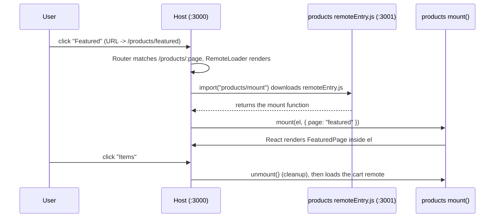

# How the Micro Frontend Works: The Full Workflow

This page explains, step by step, how three separate apps become **one page** in the browser.
Read it top to bottom. Each step points at a real file in this repo.

---

## 1. The big picture (30 seconds)

We have **three apps**. Each one is its own project, with its own `package.json` and its own dev server.

| App | Port | Role | What it owns |
|---|---|---|---|
| `host` | 3000 | The **shell** | Header, sidebar, routing |
| `products` | 3001 | A **remote** | Pages: List, Featured |
| `cart` | 3002 | A **remote** | Pages: Items, Summary |

The user only opens **http://localhost:3000**. The host downloads the code of the other two apps **while the page is running** and draws them inside itself.

```
                        Browser  (http://localhost:3000)
        ┌─────────────────────────────────────────────────────┐
        │ HOST                                                │
        │ ┌─────────────────────────────────────────────────┐ │
        │ │ Header                                          │ │
        │ ├───────────┬─────────────────────────────────────┤ │
        │ │ Sidebar   │  Content area                       │ │
        │ │  Home     │   ┌───────────────────────────────┐ │ │
        │ │  Products │   │ drawn by PRODUCTS or CART app │ │ │
        │ │  Cart     │   └───────────────────────────────┘ │ │
        │ └───────────┴─────────────────────────────────────┘ │
        └──────────────┬───────────────────────┬──────────────┘
                       │ downloads code        │ downloads code
                       ▼                       ▼
              products  :3001           cart  :3002
              (remoteEntry.js)          (remoteEntry.js)
```

**Key words**
- **Host**: the app the user visits. It decides *where* things appear.
- **Remote**: an app that shares some of its code with others. It decides *what* appears.
- **Module Federation**: the Webpack feature that lets one app load code from another app at runtime.

---

## 2. Project map

```
mico frontend/
├── pnpm-workspace.yaml      lists the three apps
├── package.json             root scripts: start:all, typecheck
├── host/                    the shell (port 3000)
│   ├── webpack.config.js    says WHERE the remotes live
│   └── src/
│       ├── index.ts         one line: import("./bootstrap")
│       ├── bootstrap.tsx    renders <App />
│       ├── App.tsx          layout + routes
│       ├── Header.tsx, Sidebar.tsx
│       ├── RemoteLoader.tsx loads a remote and calls its mount()
│       └── remotes.d.ts     TypeScript types for the remotes
├── products/                a remote (port 3001)
│   ├── webpack.config.js    says WHAT it shares (exposes)
│   └── src/
│       ├── mount.tsx        the shared function: mount(el, { page })
│       └── pages/ListPage.tsx, FeaturedPage.tsx
└── cart/                    a remote (port 3002), same shape as products
    └── src/
        ├── mount.tsx
        └── pages/ItemsPage.tsx, SummaryPage.tsx
```

---

## 3. The workflow, step by step

The steps follow the path of the code: from a remote's page, out to the host, onto the screen.

### Step 1: The remote writes normal React pages

Inside a remote, pages are plain React components with static data.
Example: [products/src/pages/ListPage.tsx](products/src/pages/ListPage.tsx) shows a list of products.

Nothing special here. A remote can still run alone.

### Step 2: The remote wraps its pages in a `mount` function

[products/src/mount.tsx](products/src/mount.tsx) is the **door** into the remote:

```tsx
export function mount(el: HTMLElement, { page = "list" }: MountProps = {}): MountResult {
  const Page = pages[page] ?? ListPage;
  const root = createRoot(el);      // start React inside the element the host gave us
  root.render(<Page />);
  return { unmount: () => setTimeout(() => root.unmount(), 0) };
}
```

This is the **contract** between host and remote:

- **In:** a DOM element (`el`) and which `page` to show.
- **Out:** an object with `unmount()`, so the host can clean up.

Why a function like this? The host never imports the remote's components. It only knows `mount`. So a remote can change everything inside, and the host does not break.

### Step 3: The remote publishes `mount` with Webpack

In [products/webpack.config.js](products/webpack.config.js):

```js
new ModuleFederationPlugin({
  name: "products",
  filename: "remoteEntry.js",
  exposes: { "./mount": "./src/mount" },   // <- "I share this file, under this name"
  shared: { react: { singleton: true }, "react-dom": { singleton: true } },
})
```

When this app runs, Webpack creates a file called **`remoteEntry.js`**, served at `http://localhost:3001/remoteEntry.js`.
Think of it as a **menu**: it lists what the app offers (`./mount`) and knows how to fetch it.

`cart` does the same on port 3002, exposing its own `./mount`.

### Step 4: The host learns where the menus are

In [host/webpack.config.js](host/webpack.config.js):

```js
new ModuleFederationPlugin({
  name: "host",
  remotes: {
    products: "products@http://localhost:3001/remoteEntry.js",
    cart:     "cart@http://localhost:3002/remoteEntry.js",
  },
  shared: { react: { singleton: true }, "react-dom": { singleton: true } },
})
```

Read `products@http://...` as: "an app named **products**, whose menu is at this URL".

After this, the host is allowed to write `import("products/mount")`:
**remote name** (`products`) + **exposed name** (`./mount`).

### Step 5: React is shared (one copy only)

Both sides declare `shared: { react: { singleton: true } }`.
That means: "load React **once**, and everyone uses that one copy".
Two copies of React in one page break hooks, so this setting is required. All three apps also pin the same React version (18.3.1).

### Step 6: Every app starts with a one-line `index.ts`

[host/src/index.ts](host/src/index.ts):

```ts
import("./bootstrap");
```

Webpack must first agree on the shared React copy, and that takes a moment (it is async).
The dynamic `import()` gives it that moment. Without it you get the error
`Shared module is not available for eager consumption`.

### Step 7: The host loads a remote and calls `mount`

[host/src/RemoteLoader.tsx](host/src/RemoteLoader.tsx) is the glue. In simple words:

```tsx
const el = document.createElement("div");           // 1. make a fresh box
containerRef.current.appendChild(el);               // 2. put it on the page

import("products/mount")                            // 3. download the remote's mount
  .then(({ mount }) => {
    mounted = mount(el, { page });                  // 4. "draw yourself in this box"
  });

return () => { mounted?.unmount(); el.remove(); };  // 5. on leave: clean up
```

Details worth knowing:
- Step 3 triggers the download of `remoteEntry.js` the first time. Later visits use the cached copy.
- A **fresh box** is made every time. Reusing one box for two React roots causes a crash (see Gotchas).
- If the remote is down, the `.catch` shows "The app is not available". The rest of the host keeps working.

### Step 8: `App.tsx` maps URLs to remotes and builds the screen

[host/src/App.tsx](host/src/App.tsx):

```tsx
<Routes>
  <Route path="/"                element={<h2>Welcome to the shell app</h2>} />
  <Route path="/products/:page"  element={<RemoteLoader remote="products" />} />
  <Route path="/cart/:page"      element={<RemoteLoader remote="cart" />} />
</Routes>
```

`:page` is a placeholder. For the URL `/products/featured`, `page` is `"featured"`, and `RemoteLoader` hands it to the remote's `mount`.

The layout is `Header` + `Sidebar` + the content area where these routes render.
[host/src/Sidebar.tsx](host/src/Sidebar.tsx) holds the links that change the URL.

**Route table: URL → remote → page**

| URL | Remote | Page shown |
|---|---|---|
| `/` | none (host) | Welcome text |
| `/products/list` | products | `ListPage` |
| `/products/featured` | products | `FeaturedPage` |
| `/products/categories` | products | `CategoriesPage` (list) |
| `/products/categories/42` | products | `CategoriesPage` (detail for id 42) |
| `/cart/items` | cart | `ItemsPage` |
| `/cart/summary` | cart | `SummaryPage` |

---

## 4. What happens when you click "Featured"

1. You click **Products → Featured** in the sidebar. React Router changes the URL to `/products/featured`. The browser does **not** reload.
2. The `/products/:page` route matches. `RemoteLoader` renders with `remote="products"` and `page="featured"`.
3. `RemoteLoader`'s effect runs. It makes a fresh `div` and calls `import("products/mount")`.
4. The browser downloads `http://localhost:3001/remoteEntry.js` (first time only), then the chunk that holds `mount`.
5. `mount(el, { page: "featured" })` runs. It creates a React root in `el` and renders `FeaturedPage`.
6. You see the Featured screen inside the host's content area.
7. You click **Items** next. The effect cleanup runs: `unmount()` on the old page, and the old `div` is removed. Then steps 3 to 6 repeat for the cart remote.



---

## 5. Failure isolation (a nice thing to demo)

Stop only the cart app (`Ctrl+C` its process or kill port 3002).

- **Products** pages still work.
- **Cart** pages show: *"The cart app is not available. Is it running?"*
- The header and sidebar never go down.

This is the main benefit of micro frontends: one broken piece does not take down the whole site.

---

## 6. TypeScript: what the types protect

The `mount` contract is the most important thing to keep in sync, so it is typed:

```ts
type MountProps  = { page?: string; id?: string; navigate?: (path: string) => void };
type MountResult = { unmount: () => void };
```

- `page` and `id` come from the URL (`/products/categories/42`).
- `navigate` is given by the host, so a remote can change the URL without having its own router.
  See [ROUTING-EXPLAINED.md](ROUTING-EXPLAINED.md) for the full story.

- Each remote's `mount.tsx` exports these types.
- The host cannot see remote code at build time (it arrives at runtime), so
  [host/src/remotes.d.ts](host/src/remotes.d.ts) **declares** the shape of `products/mount` and `cart/mount`.
  If the declaration says `mount(el, props)`, TypeScript checks every call in `RemoteLoader.tsx`.
- In larger companies these declarations are generated or published as a small package, so they cannot drift.
- Babel strips types for the build (`@babel/preset-typescript`). Type errors are caught by `pnpm typecheck` (`tsc --noEmit`).

---

## 7. How to run it

```bash
pnpm install        # at the project root, installs all three apps
pnpm start:all      # starts host (3000), products (3001), cart (3002)
pnpm typecheck      # checks types in all three apps
```

Open:
- http://localhost:3000 for the full app
- http://localhost:3001 and http://localhost:3002 to see each remote alone

---

## 8. Common gotchas

| Symptom | Cause | Fix |
|---|---|---|
| `Shared module is not available for eager consumption` | App code ran before React was negotiated | Keep `index.ts` as only `import("./bootstrap")` |
| `Script error.` / red overlay when switching pages | Two React roots on the same DOM node (an old one still unmounting) | Give every `mount` a **fresh** element (done in `RemoteLoader.tsx`) |
| Hooks crash: "Invalid hook call" | Two copies of React loaded | `shared` with `singleton: true` and the **same React version** in every app |
| Blocked by CORS in the console | Remote's dev server did not allow the host's origin | `headers: { "Access-Control-Allow-Origin": "*" }` in each remote's `devServer` |
| "Cannot find module 'products/mount'" (TypeScript) | Missing type declaration | Add it to `host/src/remotes.d.ts` |
| Host works, remote page is blank | Remote server is not running, or wrong port in `remotes` | Check `remoteEntry.js` opens in the browser |

---

## 9. One-paragraph summary (good closing line for a recording)

> Each remote writes its pages and wraps them in a `mount(el, { page })` function. Its `webpack.config.js` **exposes** that function and builds a `remoteEntry.js`. The host's `webpack.config.js` lists those `remoteEntry.js` URLs under **remotes**. When you click a link, the host's `App.tsx` route renders `RemoteLoader`, which imports the remote's `mount`, hands it a fresh DOM element, and the remote draws itself there. React is shared once, so it all behaves like a single app.
